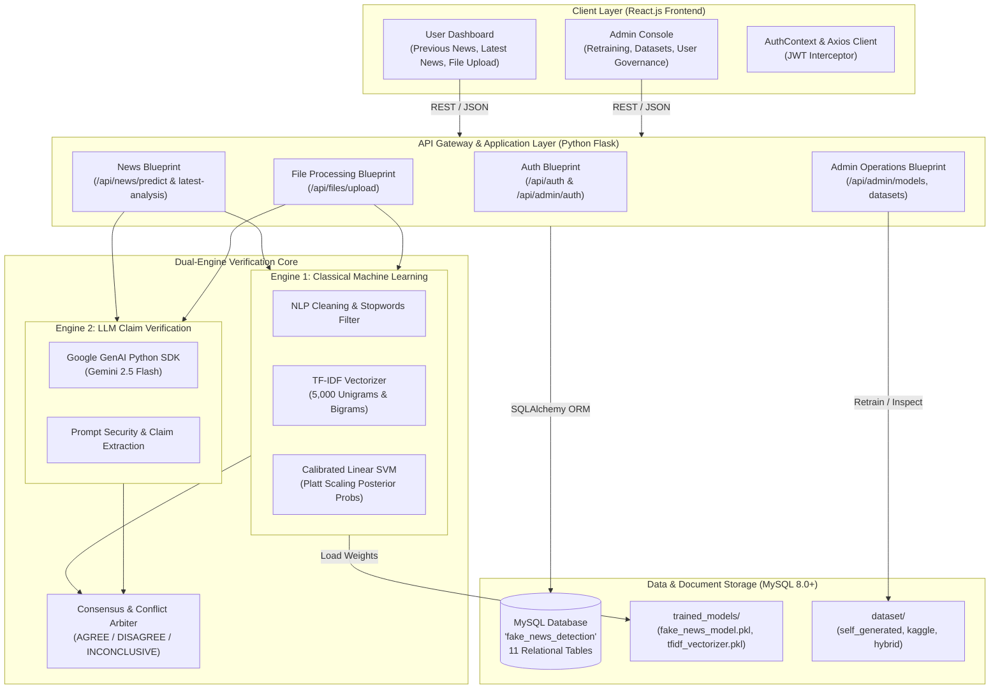

# System Architecture Diagram: AI Based Fake News Detection System

The system implements a decoupled client-server architecture with dual inference engines (Classical ML + LLM Verification) and relational persistence.

