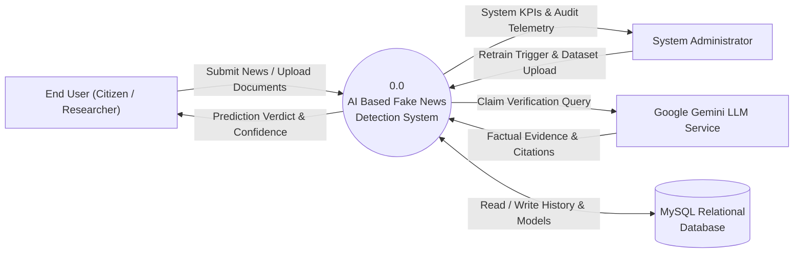
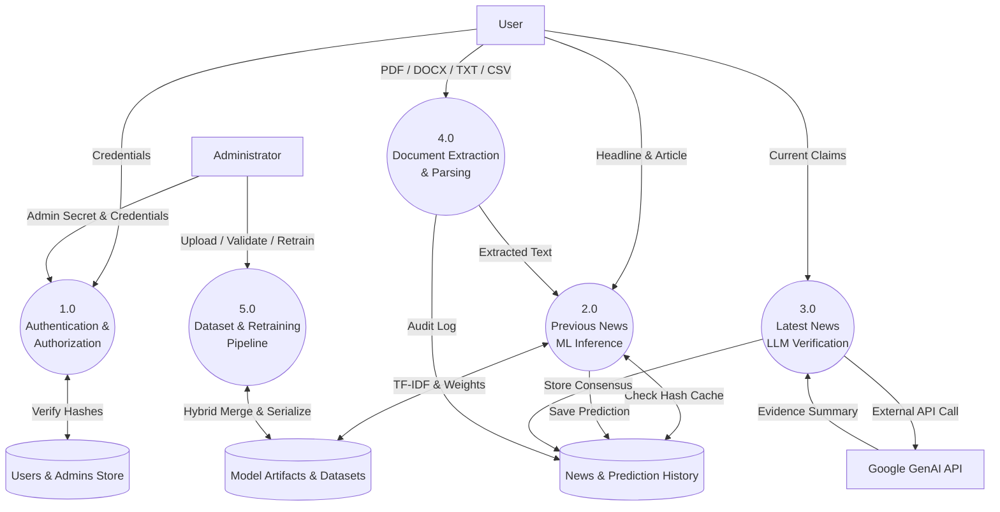

# Data Flow Diagrams (DFD): Levels 0, 1, and 2

## DFD Level 0 (Context Diagram)

The Level 0 context diagram demonstrates external entities interacting with the centralized system boundary.



---

## DFD Level 1 (Major System Subsystems)

DFD Level 1 decomposes the application into its primary operational components.



---

## DFD Level 2 (Dual-Engine Prediction Pipeline)

Detailed data flow of Process 2.0 and Process 3.0 during text analysis.

```mermaid
graph TD
    RawInput["Raw News Title & Article Body"]

    P2_1(("2.1<br/>Text Normalization<br/>& SHA-256 Hashing"))
    P2_2(("2.2<br/>Cache Lookup"))
    P2_3(("2.3<br/>Stopword Stripping<br/>& N-gram TF-IDF"))
    P2_4(("2.4<br/>Calibrated SVM<br/>Inference"))
    P2_5(("2.5<br/>Gemini Claim<br/>Prompt Evaluation"))
    P2_6(("2.6<br/>Consensus Arbiter<br/>& Signal Extraction"))
    P2_7(("2.7<br/>Relational<br/>Persistence"))

    RawInput --> P2_1
    P2_1 -->|Content Hash| P2_2
    P2_2 -->|Cache Hit| ResultOutput["Formatted Prediction Output"]
    P2_2 -->|Cache Miss| P2_3

    P2_3 -->|Sparse Feature Vector| P2_4
    P2_4 -->|Class Probabilities| P2_6

    P2_1 -->|Raw Text (If Latest Mode)| P2_5
    P2_5 -->|LLM Evidence & Verdict| P2_6

    P2_6 -->|Consensus Verdict & Confidence| P2_7
    P2_7 -->|Return JSON| ResultOutput
    P2_7 -->|INSERT SQL| DB[("MySQL Database")]
```
